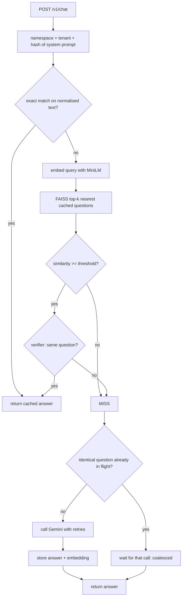

# Architecture

## Request flow

## Components

| Module | Responsibility |
|---|---|
| `app.py` | HTTP layer, namespace keying, single-flight coalescing of identical misses, metrics |
| `cache.py` | Lookup pipeline, TTL expiry, LRU eviction, persistence (JSON metadata + NumPy vectors) |
| `embedders.py` | Text to unit vectors; embedding name is stored with the cache so incompatible vectors are never mixed |
| `index.py` | `IndexIDMap2(IndexFlatIP)` so entries can be removed on expiry/eviction; NumPy fallback |
| `verifier.py` | Stage-2 check: entities, numbers, negation, antonyms, question type; optional cross-encoder |
| `llm.py` | Gemini REST client: retry with backoff on 429/5xx, clear errors for blocked/empty replies |

## Why unit vectors and inner product
All embeddings are L2-normalised, so the dot product equals cosine similarity and `IndexFlatIP` gives exact cosine search. For caches in the tens of thousands, exact search takes well under a millisecond; an approximate index (HNSW) would only matter at millions of entries.

## Verifier ordering
Cheap rules run first. The cross-encoder (tens of milliseconds) runs only on candidates that passed the rules and the similarity threshold, so it adds latency only on probable hits.

## Cache key safety
The answer to a question depends on the system prompt and model, not only on the question. The system prompt is hashed into the namespace so two personas never share answers.
